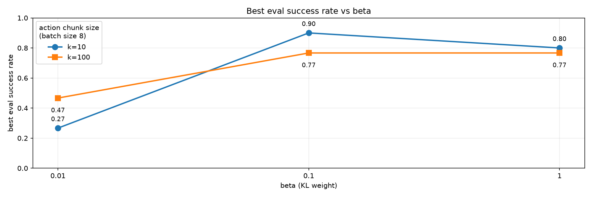

# toy-act

A minimal implementation of Action Chunking with Transformers (ACT) for the robosuite PickPlaceCan task, using robomimic demonstrations. Includes CVAE-based policy training, multi-camera inputs, and rollout evaluation.

<p align="center">
  
</p>

## Quick start

Requires Python 3.12+ and [uv](https://docs.astral.sh/uv/). Run commands from the repository root.

```bash
uv sync
```

### Prepare the data

Download the robomimic **Can / proficient-human (ph) / low_dim** dataset using the [robomimic dataset guide](https://robomimic.github.io/docs/datasets/overview.html) and place it at `datasets/can/ph/low_dim_v15.hdf5`. Render the two camera views used by the example training configuration:

```bash
uv run python -m scripts.extract_act_dataset \
    --input datasets/can/ph/low_dim_v15.hdf5 \
    --output datasets/can/ph/act_two_camera.hdf5 \
    --cameras agentview robot0_eye_in_hand
```

Rendering requires a working MuJoCo/OpenGL setup.

### Train

```bash
uv run python -m scripts.train_v2 \
    --config configs/train/act_v2/BS-32/BASE.toml \
    --dataset datasets/can/ph/act_two_camera.hdf5
```

Training settings live in the TOML configuration. Checkpoints are saved under `checkpoints/act_v2/`, and logs under `runs/act_v2/`.

### Evaluate

Replace `<checkpoint.pt>` with a checkpoint saved during training:

```bash
uv run python -m scripts.rollout \
    --checkpoint <checkpoint.pt> \
    --dataset datasets/can/ph/low_dim_v15.hdf5 \
    --n-rollouts 20
```

Evaluation opens a live viewer by default. Add `--no-on-screen` for headless evaluation (requires EGL support).

## Code

- `scripts/models/act_v2/` — ACT policy implementation.
- `scripts/train_v2.py` — training.
- `scripts/rollout.py` — rollout evaluation.
- `configs/train/` and `configs/sweep/` — training and ablation configurations.

## Training curve

<table align="center">
  <thead>
    <tr><th>lr</th><th>bs</th><th>num-steps</th><th>beta</th><th>action-loss</th><th>architecture</th></tr>
  </thead>
  <tbody>
    <tr><td>1e-4</td><td>64</td><td>100000</td><td>0.01</td><td>l1</td><td>cvae encoder-decoder</td></tr>
  </tbody>
</table>


## Ablations

### Batch size


<p align="center">
  
</p>

### Number of cameras


<p align="center">
  
</p>

### Action chunk size



Tied-action runs sweeping chunk size `k` (`configs/sweep/ph-osc-bs8-naction-tied-k{1,10,50,100}.toml`: OSC pose-delta, batch size 8, lr 1e-5, beta 0.1, 100k steps, commit `b3a1805`):

<table align="center">
  <thead>
    <tr><th>k</th><th>run outcome</th><th>wall-clock</th><th>eval success rate</th></tr>
  </thead>
  <tbody>
    <tr><td>100</td><td>success</td><td>2 h 47 m</td><td>not logged</td></tr>
    <tr><td>50</td><td>success</td><td>2 h 48 m</td><td>not logged</td></tr>
    <tr><td>10</td><td>success</td><td>3 h 09 m</td><td>not logged</td></tr>
    <tr><td>1</td><td>success</td><td>6 h 05 m</td><td>not logged</td></tr>
  </tbody>
</table>

All four runs finished and their instances were destroyed and verified; checkpoints and training events were backed up to `s3://toy-act/checkpoints/act_v2/` and `s3://toy-act/runs/act_v2/`. Post-run verification reported missing `eval/success_rate` and `throughput/*` scalars for every run, so no success rates are available yet for these chunk sizes and they are not part of the plot above.

## Acknowledgments

Based on [ACT](https://tonyzhaozh.github.io/aloha/), with demonstrations and simulation provided by [robomimic](https://robomimic.github.io/) and [robosuite](https://robosuite.ai/).
